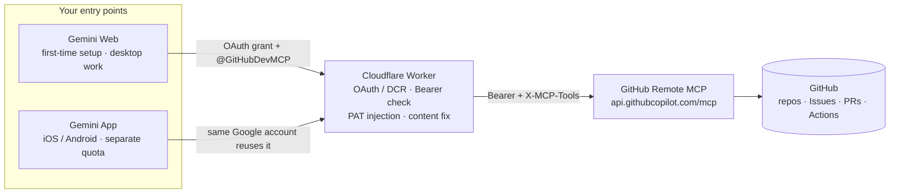
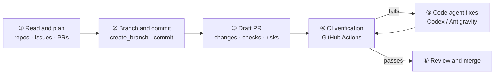

# Gemini GitHub MCP Proxy

[](https://github.com/hrygo/gemini-github-mcp-proxy/actions/workflows/ci.yml)
[](https://github.com/hrygo/gemini-github-mcp-proxy/releases/latest)
[](LICENSE)
[](https://nodejs.org/)

**Turn Gemini Web and Gemini App into a real GitHub development entry point.**

Read repositories, edit files, push commits, create pull requests, manage Issues, and use the full GitHub Remote MCP tool surface available to your token. Gemini does not need `gh`, and you do not need an always-on local development proxy.

[中文说明](README.md)

> **Ten minutes to first call**: install the CLI → run `gemini-github-mcp setup` → add `GitHubDevMCP` in Gemini. You only need a Cloudflare account and a GitHub PAT.

## Why it is useful

| Entry point | What you get | Best for |
|---|---|---|
| **Gemini App for iOS/Android** | A separately metered entry point, mobile continuity, and direct GitHub tools | Reading code, editing files, committing, and handling Issues or PRs from anywhere |
| **Gemini Web** | The same authorized Connector as Gemini App | Initial setup, desktop work, and longer chat sessions |
| **Antigravity** | A fuller local agent and development environment | Complex refactors, local builds, and sustained verification |

### Core motivation: separate development quota

Under the current Google product rules, **Gemini App and Antigravity are metered separately** ([Google One: each product has its own AI usage limits](https://support.google.com/googleone/answer/16286513?hl=en)).

Connecting GitHub development to Gemini App lets development work consume Gemini App usage instead of Antigravity quota. After authorizing the Connector once in Gemini Web, the same Google account can continue from the Gemini app.

The products are complementary: Antigravity provides the complete local environment, while Gemini App provides a separate metered entry point and mobile continuity. Complex verification can continue in GitHub Actions, Codex, or another code agent.

> Quotas, refresh periods, available models, and plan limits vary by account, region, and time. Exact limits remain defined by the corresponding Google account pages and current terms.

## Capabilities

| GitHub operation | Gemini Web / Gemini App |
|---|---|
| Read public and private repositories, files, commits, and branches | ✅ |
| Create branches, modify or delete files, and push commits | ✅ |
| Create and update pull requests, reviews, and comments | ✅ |
| Read, create, and update Issues | ✅ |
| Inspect, cancel, or rerun Actions | ✅ with the required PAT permissions |
| Manage repositories, Secrets, Packages, Discussions, and more | ✅ when exposed upstream and authorized by the PAT |

All upstream GitHub MCP tools are available by default. The GitHub PAT defines repository and resource authority; Gemini selects tools and requests your approval.

## Quick start

Four steps: **install → deploy → connect Gemini → verify**.

### Prerequisites

| Need | Notes |
|---|---|
| Node.js 22+ | Check with `node -v` |
| Cloudflare account | The free plan is enough; `setup` opens the login flow |
| GitHub PAT | Fine-grained recommended; [create one here](https://github.com/settings/personal-access-tokens/new), scopes are in “Permission model” below |
| Browser | Signed in to the Google account you use every day |

### Step 1: Install the CLI

**macOS / Linux**

```bash
curl -fsSL https://github.com/hrygo/gemini-github-mcp-proxy/releases/latest/download/install.sh | sh
```

**Windows PowerShell**

```powershell
irm https://github.com/hrygo/gemini-github-mcp-proxy/releases/latest/download/install.ps1 | iex
```

The GitHub installer verifies `SHA256SUMS`. No npm account or npm-published package is required.

<details>
<summary>Manual install (when npm is already available)</summary>

```bash
npm install --global \
  --allow-scripts=esbuild,fsevents,workerd \
  https://github.com/hrygo/gemini-github-mcp-proxy/releases/latest/download/gemini-github-mcp-proxy.tgz
```

</details>

> **Windows note**: If PowerShell blocks `.ps1` wrapper scripts under your default execution policy, run `gemini-github-mcp.cmd setup` directly without changing system policy. Use PowerShell, Windows Terminal, or CMD rather than Git Bash (`mintty`).

### Step 2: Deploy the Worker

```bash
gemini-github-mcp setup
```

It will:

1. Open the bundled Wrangler browser login if Cloudflare is not signed in yet;
2. Print the PAT creation link, then validate the token you paste;
3. Generate the 12-digit authorization PIN and signing secret;
4. Deploy the Worker and upload three Cloudflare Secrets;
5. Verify the OAuth, DCR, MCP, and authentication endpoints.

On success, the terminal prints:

```text
Connector 名称：GitHubDevMCP
MCP URL：https://gemini-github-mcp-proxy.<your-subdomain>.workers.dev/mcp
授权 PIN：<shown once>
GitHub MCP 工具范围：全部（默认透传）
```

> **Save the PIN first.** It is shown only once and you need it in the next step. If you lose it, run `gemini-github-mcp setup --pin-only` to generate a new one without breaking existing connections.

### Step 3: Connect Gemini

1. Open [Gemini Web](https://gemini.google.com/app) → Settings → Connected apps.
2. Add a custom MCP app named `GitHubDevMCP`.
3. Enter the `/mcp` URL printed by the previous step.
4. Complete OAuth and enter the 12-digit PIN.
5. Open Gemini App with the same Google account and reuse the Connector.

> **The name must be unique and space-free.** Do not use a name such as `GitHub Dev MCP` that starts with an installed app; the `@` mention may resolve to the built-in GitHub first. Keep it a single word without spaces, hyphens, underscores, or dots.
>
> **The authorization page is valid for about 10 minutes.** If you see `Session token is expired`, restart the connector flow in Gemini instead of refreshing the old page.

#### If Gemini says it cannot register automatically

Copy the redirect URI from the dialog and run:

```bash
gemini-github-mcp client --redirect-uri "<redirect URI>"
```

Paste the returned client ID and secret back into the dialog. A current Worker returns a server-derived secret; an older Worker returns none, so the CLI generates a local one and prints a notice.

### Step 4: Verify

Open a new chat, type `@`, select `GitHubDevMCP` from the menu, and send:

```text
List my 5 most recently updated repositories. Do not modify anything.
```

A repository list means the connection works. The first tool call asks for approval; choose “Allow once”.

> Every new chat needs a fresh `@` selection from the menu. Typing `@GitHubDevMCP` as plain text does not bind the tools.

### Stuck?

| Symptom | Fix |
|---|---|
| `GitHubDevMCP` is missing from the `@` menu | Confirm the name is unique, start a new chat, and pick it from the menu |
| “Authorize and continue” does nothing | The page expired; re-add the Connector from Gemini |
| “Could not register” message | Register manually with `gemini-github-mcp client --redirect-uri` |
| The model says tools are unavailable | Confirm the `@` binding and use “Auto” or `Neon` mode |
| Requests return 401 | Delete and re-add the Connector, then authorize again |
| `429 Too many authorization attempts` | Wait 60 seconds; do not script retries |

More branches are covered in [TROUBLESHOOTING.md](TROUBLESHOOTING.md).

## Architecture

### Shared entry points



### Development loop



The Worker supplies the OAuth/DCR and refresh compatibility Gemini needs, keeps the PAT outside Gemini, and converts GitHub text `EmbeddedResource` blocks into content Gemini can read.

## Permission model

| Layer | What it controls |
|---|---|
| GitHub PAT | Repository scope, resource type, and read/write authority |
| GitHub Remote MCP | The upstream tools currently available |
| Gemini | Tool selection and per-action approval |
| Worker | OAuth, Bearer validation, PAT injection, and file-content compatibility |

A fine-grained PAT with Metadata read, Contents read/write, Issues read/write, and Pull requests read/write is a practical development baseline. Add Workflows write, Actions read/write, or other permissions as needed. Classic PAT scopes work too.

### Optional tool narrowing

Use every upstream tool by default, or narrow the tool surface explicitly:

```bash
gemini-github-mcp setup --tools get_file_contents,create_branch,create_or_update_file,create_pull_request
```

Restore the complete upstream set:

```bash
gemini-github-mcp setup --tools all
```

Running `setup --tools ...` on an existing deployment (without `--rotate`) updates only the tool scope while preserving your existing PAT, authorization PIN, and Gemini Connector. The selection is stored as non-sensitive local configuration and reused by `setup --rotate`; invalid options are reported immediately.

## Example workflow

```text
@GitHubDevMCP Read owner/repo and the related Issue.
Analyze the current state and propose a plan before writing files.
```

```text
@GitHubDevMCP Implement the confirmed plan on a new branch, commit the changes,
and open a Draft PR with validation notes and risks.
```

Gemini can create branches, commits, pull requests, reviews, and Issue comments. GitHub Actions, Codex, or another code agent can then run tests and continue the fix from the same branch or PR.

## Security by design

- The PAT stays in Cloudflare Secrets and is never sent to Gemini.
- OAuth supports Dynamic Client Registration with an `mcp-client-v2-*` client ID and derived secret, while remaining compatible with legacy `mcp-client-*` public clients; S256 PKCE is mandatory.
- Gemini callback origins and paths are restricted to the expected OAuth redirect prefix.
- `/mcp` requires a signed Bearer token issued by the Worker.
- PIN submissions use Cloudflare Rate Limiting with a 10-attempt, 60-second approximate threshold per source IP.
- The authorization page uses `no-store`, CSP, `X-Frame-Options: DENY`, and no-referrer headers.

See [SECURITY.md](SECURITY.md) for the full threat model and token rotation procedure.

## Operations

```bash
gemini-github-mcp status
gemini-github-mcp verify
gemini-github-mcp setup --tools ...
gemini-github-mcp setup --pin-only
gemini-github-mcp setup --rotate
gemini-github-mcp client --redirect-uri ...
gemini-github-mcp login
```

| Command | Purpose |
|---|---|
| `gemini-github-mcp status` | Show local deployment config (MCP URL, tool scope, config time) and live `/health` status |
| `gemini-github-mcp verify` | Verify live health, OAuth metadata, DCR, and `/mcp` auth protection |
| `gemini-github-mcp setup --tools ...` | Update exposed GitHub MCP tools without rotating Secrets or breaking Gemini auth |
| `gemini-github-mcp setup --pin-only` | Rotate only the authorization PIN while preserving the PAT, signing secret, and existing connections |
| `gemini-github-mcp setup --rotate` | Rotate PAT, PIN, and signing secret and redeploy |
| `gemini-github-mcp client --redirect-uri ...` | Register a manual OAuth client when DCR fails |
| `gemini-github-mcp login` | Log in or switch Cloudflare accounts using bundled Wrangler |
| `gemini-github-mcp verify --url ...` | Verify a specific Worker URL |

Upgrade by rerunning the installer. Uninstall with:

```bash
npm uninstall --global gemini-github-mcp-proxy
```

## Design boundaries

- Gemini App focuses on cloud GitHub operations; GitHub Actions and code agents carry the work through local builds and full verification.
- Cloudflare Rate Limiting is approximate and scoped by edge location. The random 12-digit PIN, S256 PKCE, and HTTPS remain the primary authentication boundary.
- Access and refresh tokens are stateless 10-year signed tokens. `setup --pin-only` only changes the authorization PIN; `setup --rotate` rotates `SIGNING_SECRET` and invalidates all existing tokens together.
- Authorization codes use stateless signatures with a 10-minute lifetime, backed by PKCE and signature validation. This keeps the Worker lightweight and resilient.

## Share

Share the [latest GitHub Release](https://github.com/hrygo/gemini-github-mcp-proxy/releases/latest). Every user deploys with their own Cloudflare account, GitHub PAT, and random authorization PIN.

## Cost

Personal use fits within Cloudflare Workers Free. As of 2026-11-22, the official free tier includes 100,000 requests per day and 10 ms CPU per request. Higher traffic or stricter limits can use a Cloudflare plan as needed.

- [Cloudflare Workers Pricing](https://developers.cloudflare.com/workers/platform/pricing/)
- [Cloudflare Workers Limits](https://developers.cloudflare.com/workers/platform/limits/)

## Development

```bash
npm install
npm run check
npm run dev
npm run pack:release
```

Tests cover OAuth/DCR, client-secret validation and HTTP Basic, mandatory PKCE, callback restrictions, full tool passthrough, optional tool filtering, authorization rate limiting, JSON/SSE normalization, PIN-only rotation, manual client registration, installers, and deployment helpers. See [TROUBLESHOOTING.md](TROUBLESHOOTING.md) and [RELEASING.md](RELEASING.md).

## References

- [Google Gemini: connect and manage custom apps](https://support.google.com/gemini/answer/17209137)
- [Google One: each product has its own AI usage limits](https://support.google.com/googleone/answer/16286513?hl=en)
- [Google Antigravity: Plans](https://antigravity.google/docs/plans)
- [GitHub Remote MCP Server configuration](https://github.com/github/github-mcp-server/blob/main/docs/remote-server.md)
- [GitHub MCP tool-specific configuration](https://github.blog/changelog/2025-12-10-the-github-mcp-server-adds-support-for-tool-specific-configuration-and-more)
- [GitHub MCP: Gemini DCR/refresh compatibility issue](https://github.com/github/github-mcp-server/issues/3519)
- [GitHub MCP: EmbeddedResource file-body issue](https://github.com/github/github-mcp-server/issues/3189)
