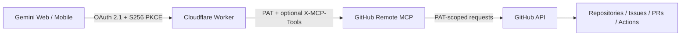

# Gemini GitHub MCP Proxy

Use GitHub from Gemini Web and the Gemini mobile app without `gh`: read repositories, edit files, push commits, create pull requests, manage Issues, and call every tool exposed by GitHub Remote MCP that your token permits.

Deploy one Worker per person with that person's own GitHub PAT. The Worker does not impose a second tool whitelist: **the PAT defines GitHub authority, and the user decides which tools each task uses.**

## Install

No npm account is required. Packages are distributed through GitHub Releases.

**macOS / Linux**

```bash
curl -fsSL https://github.com/hrygo/gemini-github-mcp-proxy/releases/latest/download/install.sh | sh
```

**Windows PowerShell**

```powershell
irm https://github.com/hrygo/gemini-github-mcp-proxy/releases/latest/download/install.ps1 | iex
```

Manual install:

```bash
npm install --global \
  --allow-scripts=esbuild,fsevents,workerd \
  https://github.com/hrygo/gemini-github-mcp-proxy/releases/latest/download/gemini-github-mcp-proxy.tgz
```

The GitHub installer verifies `SHA256SUMS`. Public npm Registry access is used for dependencies, but the tool itself does not need an npm account or npm publishing.

## Permission model

All upstream GitHub MCP tools are exposed by default. Actual results depend on:

| Layer | Responsibility |
|---|---|
| GitHub PAT | Repository access and resource permissions |
| GitHub Remote MCP | Tools currently available upstream |
| Gemini | Tool selection and per-action approval |

Use a fine-grained PAT and choose only the repositories and permissions you want. A common writable development baseline is Metadata read, Contents read/write, Issues read/write, and Pull requests read/write. Add Workflows write when editing workflow files, Actions read/write for CI operations, and other permissions when you intentionally need them. Classic PAT scopes work too.

To reduce context or explicitly expose a subset:

```bash
gemini-github-mcp setup --tools get_file_contents,create_branch,create_or_update_file,create_pull_request
```

The selection is persisted as non-sensitive local configuration and reused by `setup --rotate`. Use `--tools all` to restore the full upstream set. Invalid or incomplete options fail closed instead of silently falling back to all tools.

## Deploy

```bash
npx wrangler login
gemini-github-mcp setup
```

The installer and setup command never persist the PAT, authorization PIN, or signing secret outside Cloudflare Secrets.

## Connect Gemini

1. Open Gemini Web → Settings → Connected apps.
2. Add a custom MCP app named `GitHub Dev MCP`.
3. Enter the MCP URL printed by setup.
4. Complete OAuth and enter the generated 12-digit PIN.
5. The same Google account can use the connector on Gemini mobile.

In every new chat, type `@`, select `GitHub Dev MCP`, then enter the task.

## Architecture



The Worker exists to bridge Gemini's OAuth registration/refresh requirements, keep the PAT out of Gemini, and convert embedded text resources that Gemini otherwise drops.

## Security

- The Worker injects a PAT stored only in Cloudflare Secrets.
- Gemini never receives the PAT.
- OAuth uses public-client DCR and mandatory S256 PKCE.
- Authorization PIN submissions are limited to 10 attempts per source per minute with Cloudflare Rate Limiting.
- `/mcp` requires a signed Bearer token.
- The tool surface is not silently reduced. High-impact operations still require a capable PAT and your explicit instruction/approval.
- Access and refresh tokens are stateless 10-year signed tokens; rotating `SIGNING_SECRET` revokes them together.
- Cloudflare Rate Limiting is approximate and scoped by edge location; it is defense in depth, not an account system.

See [SECURITY.md](SECURITY.md) and [TROUBLESHOOTING.md](TROUBLESHOOTING.md).

## Share

Share the [latest GitHub Release](https://github.com/hrygo/gemini-github-mcp-proxy/releases/latest), never an already-authorized Worker URL. Every user should deploy with their own Cloudflare account and GitHub PAT.
