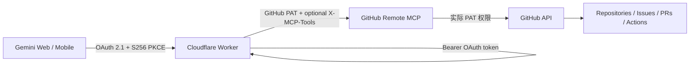
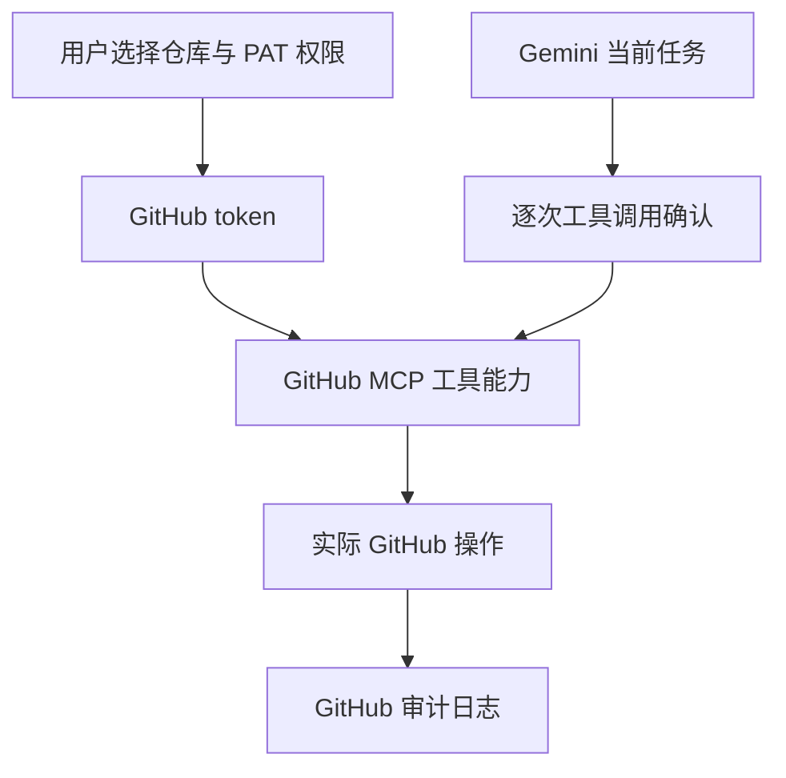

# Gemini GitHub MCP Proxy

让 Gemini Web 与 Gemini 手机 App 通过 GitHub 官方 Remote MCP 完成真实开发操作：读取仓库、修改文件、提交 commit、创建 PR、处理 Issue，不依赖 Gemini 执行 `gh`。

每个使用者部署自己的 Cloudflare Worker，并绑定自己的 GitHub PAT。Worker 不内置工具权限白名单：**GitHub 能做什么由 PAT 决定，某次任务调用哪些工具由你决定。**

[English quick start](README.en.md)

## 能力与权限边界

默认透传 GitHub Remote MCP 当前提供的全部工具。只要 PAT 与仓库策略允许，即可使用代码、Issue、PR、Actions、发布、仓库管理等能力。

实际权限由三层共同决定：

| 层 | 决定什么 |
|---|---|
| GitHub PAT | 能访问哪些仓库、读写哪些资源 |
| GitHub 服务端 | 当前 Remote MCP 实际提供哪些工具 |
| Gemini | 当前任务调用哪个工具，以及每次操作是否获得你的许可 |

Worker 只负责 OAuth、PAT 隔离和文件正文兼容，不额外猜测或删减你的 GitHub 权限。

如果希望缩小上下文或主动限制工具集，可显式传入 `--tools`：

```bash
gemini-github-mcp setup --tools all
gemini-github-mcp setup --tools get_file_contents,create_branch,create_or_update_file,create_pull_request
```

工具选择会写入本机非敏感配置，后续运行 `setup --rotate` 时继续沿用；恢复全部工具需显式执行 `setup --tools all`。参数会严格校验：拼错 `--tools` 或漏传值会直接终止，不会静默回落到全部工具。

## 安装

不需要注册 npm 账号。安装包由 GitHub Release 提供。

**macOS / Linux**

```bash
curl -fsSL https://github.com/hrygo/gemini-github-mcp-proxy/releases/latest/download/install.sh | sh
```

**Windows PowerShell**

```powershell
irm https://github.com/hrygo/gemini-github-mcp-proxy/releases/latest/download/install.ps1 | iex
```

手动安装：

```bash
npm install --global \
  --allow-scripts=esbuild,fsevents,workerd \
  https://github.com/hrygo/gemini-github-mcp-proxy/releases/latest/download/gemini-github-mcp-proxy.tgz
```

安装包依赖从 npm 公共 Registry 下载，但工具本身不需要 npm 账号或 npm 发布。安装器会校验 `SHA256SUMS`。

升级时重新执行安装命令。卸载：

```bash
npm uninstall --global gemini-github-mcp-proxy
```

## 准备

- Node.js 22+
- Cloudflare 账号
- GitHub Personal Access Token

推荐使用 fine-grained PAT，并自行选择仓库范围。一个常见的可写开发起点是：

| 权限 | 建议级别 | 用途 |
|---|---|---|
| Metadata | Read | 必要基础权限 |
| Contents | Read and write | 文件、分支、commit |
| Issues | Read and write | Issue 与评论 |
| Pull requests | Read and write | PR、审阅与评论 |
| Workflows | Write | 修改 `.github/workflows` 时 |
| Actions | Read and write | 查看或重跑 Actions 时 |

需要 Secrets、Administration、Packages、Discussions 等能力时，按实际工具自行增加；缺少权限时 GitHub 会返回 403。classic PAT 也可使用，实际能力由所选的 `repo`、`workflow`、`read:org`、`project` 等 scope 决定。

> PAT 就是最终授权边界。不要为了让工具“看起来安全”而在 Worker 里再复制一份权限判断，也不要向他人共享 PAT。

## 部署

```bash
npx wrangler login
gemini-github-mcp setup
```

`setup` 会：

1. 检查 Cloudflare 登录状态
2. 安全读取并验证 GitHub PAT
3. 生成随机 12 位授权 PIN 和签名密钥
4. 部署 Worker
5. 一次上传三个 Cloudflare Secrets
6. 验收 OAuth、DCR、MCP 与鉴权端点
7. 输出 Connector URL、授权 PIN 和工具范围

成功后终端会显示：

```text
Connector 名称：GitHub Dev MCP
MCP URL：https://gemini-github-mcp-proxy.<你的子域>.workers.dev/mcp
授权 PIN：<只显示一次>
GitHub MCP 工具范围：全部（默认透传）
```

PAT、授权 PIN 和签名密钥不会写入仓库或配置文件。非敏感部署信息保存在用户配置目录，供 `gemini-github-mcp verify` 使用。

## 接入 Gemini

1. 在 Gemini Web 打开 `设置 → 已连接的应用`。
2. 添加自定义 MCP App，名称填写 `GitHub Dev MCP`。
3. MCP URL 使用 setup 输出的地址。
4. Gemini 自动完成动态客户端注册；授权页输入部署时生成的 12 位 PIN。
5. 手机端使用同一 Google 账号即可看到该 Connector。

每个新聊天必须：

1. 输入 `@`。
2. 从自动完成菜单明确选择 `GitHub Dev MCP`。
3. 再输入任务。

只在正文中手写 `@GitHub Dev MCP` 不会可靠绑定工具。

## 使用建议

先读后写：

```text
@GitHub Dev MCP 读取 owner/repo 和相关 Issue。
先分析现状并给出修改计划，不要写文件。
```

确认后实施：

```text
@GitHub Dev MCP 按已确认方案创建新分支，修改文件并提交。
创建 Draft PR，说明变更、验证和风险。
```

Issue 协作：

```text
@GitHub Dev MCP 读取 Issue #123，在同一 Issue 回复结论和对应 Draft PR。
```

需要删除文件、合并 PR、创建仓库或其他高影响操作时，直接明确写出目标与范围，并在 Gemini 的逐次许可提示中核对参数。是否执行由你决定。

Gemini 没有本地 shell 和文件系统；提交后可让 GitHub Actions、Codex 或其他 code agent 接管测试和继续修复。

## 常用命令

```bash
gemini-github-mcp setup
gemini-github-mcp setup --rotate
gemini-github-mcp setup --tools get_file_contents,pull_request_read
gemini-github-mcp verify
gemini-github-mcp verify --url https://example.workers.dev
```

开发源码时：

```bash
npm install
npm run check
npm run dev
```

## 工作流程





需要 Worker 的原因：

- GitHub Remote MCP 当前未完整满足 Gemini 所需的 DCR 与 refresh token 组合。
- Gemini 会丢弃 GitHub 文件工具返回的 `EmbeddedResource`，只剩 SHA 状态文本。
- PAT 不能安全地交给 Gemini 或移动端浏览器。

## 安全与限制

- 授权 PIN 为随机 12 位数字，只在 setup 中显示一次。
- 授权 PIN 提交入口使用 Cloudflare Rate Limiting，按来源每分钟允许 10 次尝试。
- `ADMIN_PIN`、`SIGNING_SECRET`、`GITHUB_PAT` 只存 Cloudflare Secret。
- `/mcp` 必须携带签名有效、强制 S256 PKCE 流程签发的 Bearer token。
- 当前 access token 与 refresh token 均为无状态签名令牌，有效期 10 年；轮换 `SIGNING_SECRET` 会统一失效。
- 授权码没有服务端一次性消费记录；10 分钟有效期内理论上可重放，但仍需 PKCE 与有效签名。
- 断开 Gemini Connector 不等于立即吊销服务端令牌。
- Worker 不执行代码，也不是 GitHub PAT 之外的权限沙箱。
- Cloudflare Rate Limiting 是按边缘位置近似计数，不保证全球严格单点限流；它是 PIN 暴力的纵深防护，不是账户系统。

完整威胁模型与轮换步骤见 [SECURITY.md](SECURITY.md)。

## 分享给朋友

分享 [Latest Release](https://github.com/hrygo/gemini-github-mcp-proxy/releases/latest)，不要分享已经授权的 Worker：

```bash
curl -fsSL https://github.com/hrygo/gemini-github-mcp-proxy/releases/latest/download/install.sh | sh
npx wrangler login
gemini-github-mcp setup
```

每个朋友应使用自己的 Cloudflare 账号、GitHub PAT 和授权 PIN。

## 成本

个人使用 Cloudflare Workers Free 即可。截至 2026-11-22，官方免费额度为每天 100,000 次请求、每次 10ms CPU。[Cloudflare Workers Pricing](https://developers.cloudflare.com/workers/platform/pricing/) 与 [Limits](https://developers.cloudflare.com/workers/platform/limits/) 可能变化；高流量或更高限制需要自行选择 Cloudflare 套餐。

## 排障与开发

常见问题见 [TROUBLESHOOTING.md](TROUBLESHOOTING.md)。优先运行：

```bash
gemini-github-mcp verify
npx wrangler deployments status
```

测试覆盖 OAuth/DCR、强制 PKCE、公共客户端注册、全工具透传、可选工具过滤、JSON/SSE 文件正文转换和部署辅助函数。发布流程与制品规范见 [RELEASING.md](RELEASING.md)。

## 参考

- [Google：连接和管理自定义 Gemini App](https://support.google.com/gemini/answer/17209137)
- [GitHub Remote MCP Server 配置](https://github.com/github/github-mcp-server/blob/main/docs/remote-server.md)
- [GitHub MCP 工具级配置 X-MCP-Tools](https://github.blog/changelog/2025-12-10-the-github-mcp-server-adds-support-for-tool-specific-configuration-and-more)
- [GitHub MCP：Gemini DCR/refresh 兼容问题](https://github.com/github/github-mcp-server/issues/3519)
- [GitHub MCP：EmbeddedResource 文件正文问题](https://github.com/github/github-mcp-server/issues/3189)
