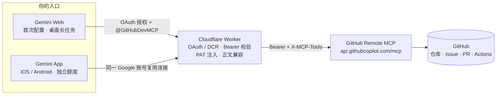
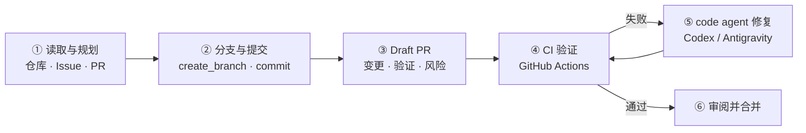

# Gemini GitHub MCP Proxy

[](https://github.com/hrygo/gemini-github-mcp-proxy/actions/workflows/ci.yml)
[](https://github.com/hrygo/gemini-github-mcp-proxy/releases/latest)
[](LICENSE)
[](https://nodejs.org/)

**让 Gemini Web 与 Gemini App 直接成为 GitHub 开发入口。**

读取仓库、修改文件、提交 commit、创建 PR、处理 Issue，并通过 GitHub 官方 Remote MCP 使用你授权的完整工具集。无需 Gemini 执行 `gh`，也无需本机常驻开发代理。

[English quick start](README.en.md)

> **10 分钟内上手**：安装 CLI → 运行 `gemini-github-mcp setup` → 在 Gemini 添加 `GitHubDevMCP`。全程只需一个 Cloudflare 账号和一个 GitHub PAT。

## 为什么值得用

| 入口 | 你获得什么 | 适合什么 |
|---|---|---|
| **Gemini App（iOS/Android）** | 独立额度入口、移动端连续操作、直接调用 GitHub 工具 | 随时随地读代码、改文件、提交 commit、处理 Issue 和 PR |
| **Gemini Web** | 与 Gemini App 共享同一个已授权 Connector | 首次配置、桌面端长任务和完整聊天界面 |
| **Antigravity** | 更完整的本地 agent、构建环境和持续验证能力 | 复杂重构、长时间运行和本地测试 |

### 核心动因：让 Gemini App 成为独立开发额度入口

按当前 Google 产品规则，**Gemini App 与 Antigravity 的 AI 使用额度分别计量**（[Google One 官方说明](https://support.google.com/googleone/answer/16286513?hl=zh-Hans)）。

这意味着你可以让 GitHub 开发任务使用 Gemini App 的额度，而不占用 Antigravity 的额度；同时，在 Gemini Web 完成一次 Connector 授权后，同一 Google 账号可以直接在 Gemini App 继续工作。

Antigravity 与 Gemini App 是互补关系：前者提供完整的本地开发环境，后者提供独立计量入口和移动端连续性。复杂验证可以继续交给 GitHub Actions、Codex 或其他 code agent。

> 额度上限、刷新周期、可用模型和套餐规则会随账号、地区与时间变化；本文确认的是两个产品分别计量，具体额度以 Google 当前账户页面和条款为准。

## 能做什么

| GitHub 操作 | Gemini Web / Gemini App |
|---|---|
| 读取公开与私有仓库、文件、commit、branch | ✅ |
| 创建分支、修改或删除文件、提交 commit | ✅ |
| 创建和更新 PR、添加审阅与评论 | ✅ |
| 读取、创建、更新 Issue 与评论 | ✅ |
| 查看、取消或重跑 Actions | ✅，需要 PAT 对应权限 |
| 管理仓库、Secrets、Packages、Discussions 等 | ✅，取决于上游工具与 PAT 权限 |

默认透传 GitHub Remote MCP 当前提供的完整工具面。GitHub PAT 决定访问哪些仓库、能读写哪些资源；Gemini 负责选择工具并获得你的逐次许可。

## 快速开始

四步完成：**安装 → 部署 → 接入 Gemini → 验证**。

### 准备

| 需要 | 说明 |
|---|---|
| Node.js 22+ | 用 `node -v` 确认版本 |
| Cloudflare 账号 | 免费版即可；`setup` 会引导登录 |
| GitHub PAT | 建议 fine-grained；[创建入口](https://github.com/settings/personal-access-tokens/new)，权限见下文「权限由你掌控」 |
| 浏览器 | 已登录你日常使用的 Google 账号 |

### 第 1 步：安装 CLI

**macOS / Linux**

```bash
curl -fsSL https://github.com/hrygo/gemini-github-mcp-proxy/releases/latest/download/install.sh | sh
```

**Windows PowerShell**

```powershell
irm https://github.com/hrygo/gemini-github-mcp-proxy/releases/latest/download/install.ps1 | iex
```

安装包由 GitHub Release 分发并校验 `SHA256SUMS`；不需要 npm 账号，也不需要把本工具发布到 npm。

<details>
<summary>手动安装（npm 已就绪时）</summary>

```bash
npm install --global \
  --allow-scripts=esbuild,fsevents,workerd \
  https://github.com/hrygo/gemini-github-mcp-proxy/releases/latest/download/gemini-github-mcp-proxy.tgz
```

</details>

> **Windows 提示**：如果默认 PowerShell 执行策略禁止运行 `.ps1` 包装脚本，安装后直接运行 `gemini-github-mcp.cmd setup` 即可（无需修改系统策略）。请使用 PowerShell、Windows Terminal 或 CMD，避免在 Git Bash（mintty）下遇到非交互终端限制。

### 第 2 步：部署 Worker

```bash
gemini-github-mcp setup
```

它会依次完成：

1. 未登录 Cloudflare 时自动打开浏览器引导登录；
2. 提示 PAT 创建入口并验证你粘贴的 token；
3. 生成 12 位授权 PIN 与签名密钥；
4. 部署 Worker 并上传三个 Cloudflare Secrets；
5. 验收 OAuth、DCR、MCP 与鉴权端点。

成功后终端会输出：

```text
Connector 名称：GitHubDevMCP
MCP URL：https://gemini-github-mcp-proxy.<你的子域>.workers.dev/mcp
授权 PIN：<只显示一次>
GitHub MCP 工具范围：全部（默认透传）
```

> **先保存 PIN。** 它只显示一次，下一步接入 Gemini 时要用。遗失后运行 `gemini-github-mcp setup --pin-only` 重新生成，现有连接不会失效。

### 第 3 步：接入 Gemini

1. 打开 [Gemini Web](https://gemini.google.com/app) 的 `设置 → 已连接的应用`。
2. 添加自定义 MCP App，名称填写 `GitHubDevMCP`。
3. 填入上一步输出的 `/mcp` 地址。
4. 完成 OAuth，并输入 12 位授权 PIN。
5. 使用同一 Google 账号打开 Gemini App，即可复用该 Connector。

> **名称必须唯一且不含空格。** 不要用 `GitHub Dev MCP` 这类以已安装应用开头的名称，`@` 提及可能先命中内置 GitHub。保持单个词，不含空格、`-`、`_`、`.`。
>
> **授权页约 10 分钟内有效。** 若提示 `Session token is expired`，请回到 Gemini 重新添加 Connector，不要刷新旧授权页。

#### 如果 Gemini 提示“未能自动向此服务器注册”

复制弹窗里的重定向 URI，然后运行：

```bash
gemini-github-mcp client --redirect-uri "<重定向 URI>"
```

把输出的客户端 ID 和客户端密钥填回弹窗。新版 Worker 返回服务端派生的密钥；旧版 Worker 会生成本地密钥并给出提示。

### 第 4 步：验证

新建聊天，输入 `@`，从菜单选择 `GitHubDevMCP`，发送：

```text
列出我最近更新的 5 个仓库，不要修改任何内容。
```

看到仓库列表即接入成功。首次工具调用会请求许可，选择“允许一次”即可。

> 每个新聊天都要重新输入 `@` 并从菜单点选；只在正文手写 `@GitHubDevMCP` 不会绑定工具。

### 卡住了？

| 现象 | 处理 |
|---|---|
| `@` 菜单里没有 `GitHubDevMCP` | 确认名称唯一、已新建聊天、是从菜单点选而非手打 |
| 授权页点“授权并继续”无反应 | 页面已过期，回 Gemini 重新添加 Connector |
| 提示“未能自动注册” | 用 `gemini-github-mcp client --redirect-uri` 手动注册 |
| 模型说工具不可用 | 确认 `@` 已绑定，模式选“自动”或 `Neon` |
| 请求返回 401 | 删除并重新添加 Connector，重新授权 |
| `429 Too many authorization attempts` | 等待 60 秒再试，不要脚本化重试 |

更多分支见 [TROUBLESHOOTING.md](TROUBLESHOOTING.md)。

## 工作流程

### 双端接入



### 开发闭环



Cloudflare Worker 负责三件事：补齐 Gemini 所需的 OAuth/DCR 与 refresh 兼容、把 PAT 隔离在 GitHub 之外、将 GitHub 返回的文本 `EmbeddedResource` 转成 Gemini 可读的文本内容。

## 权限由你掌控

| 层 | 你决定什么 |
|---|---|
| GitHub PAT | 仓库范围、资源类型和读写权限 |
| GitHub Remote MCP | 当前可调用的官方工具 |
| Gemini | 当前任务使用哪个工具，以及是否允许执行 |
| Worker | OAuth、Bearer 校验、PAT 注入与文件正文兼容 |

推荐使用 fine-grained PAT。常见可写开发起点：

| 权限 | 建议级别 | 用途 |
|---|---|---|
| Metadata | Read | GitHub 基础元数据 |
| Contents | Read and write | 文件、分支、commit |
| Issues | Read and write | Issue 与评论 |
| Pull requests | Read and write | PR、审阅与评论 |
| Workflows | Write | 修改 `.github/workflows` |
| Actions | Read and write | 查看或重跑 Actions |

需要 Secrets、Administration、Packages、Discussions 等能力时，按实际任务增加对应权限。classic PAT 同样可用，能力由所选 scope 决定。

### 可选：主动收窄工具集

默认完整透传，便于 Gemini 使用 GitHub 的全部能力。需要更聚焦的上下文或更小的工具面时，可显式选择：

```bash
gemini-github-mcp setup --tools get_file_contents,create_branch,create_or_update_file,create_pull_request
```

恢复完整工具集：

```bash
gemini-github-mcp setup --tools all
```

在已有部署上仅传入 `--tools`（不带 `--rotate`）只会更新工具范围，保留现有 PAT、授权 PIN 与 Gemini Connector，无需重新授权。工具选择会写入本机非敏感配置，并由后续 `setup --rotate` 沿用；参数采用严格校验，输入有误会直接提示。

## 推荐用法

先读后写：

```text
@GitHubDevMCP 读取 owner/repo 和相关 Issue。
分析现状并给出修改计划，本轮保持只读。
```

确认后实施：

```text
@GitHubDevMCP 按已确认方案创建新分支，修改目标文件并提交 commit。
创建 Draft PR，说明变更、验证方式和风险。
```

Issue 协作：

```text
@GitHubDevMCP 读取 Issue #123，在同一 Issue 回复结论，并关联对应的 Draft PR。
```

需要删除文件、合并 PR、创建仓库、修改 Actions 等能力时，可以直接描述目标与范围。Gemini 会请求对应工具许可，GitHub PAT 则确保操作只能发生在其授权范围内。

## 安全设计

- **PAT 不进入 Gemini。** `GITHUB_PAT` 只保存在 Cloudflare Secret，由 Worker 注入 GitHub Remote MCP。
- **OAuth 同时支持自动与手动客户端。** DCR 会返回 `mcp-client-v2-*` 客户端 ID 和派生密钥，同时兼容旧 `mcp-client-*` 公共客户端；强制 S256 PKCE，并锁定 Gemini 官方回调前缀。
- **MCP 端点受签名令牌保护。** `/mcp` 只接受由本 Worker 签发的有效 Bearer token。
- **授权入口带限流。** PIN 提交使用 Cloudflare Rate Limiting，按来源 IP 配置 `10 次/60 秒` 的边缘近似阈值。
- **部署凭据不落盘。** `setup` 通过 stdin 上传三个 Cloudflare Secrets；PAT、PIN 与签名密钥不写入仓库或配置文件。
- **授权页有浏览器防护。** 返回 `no-store`、CSP、禁止 iframe 和 no-referrer 响应头。

完整威胁模型、令牌语义和轮换步骤见 [SECURITY.md](SECURITY.md)。

## 日常运维

```bash
gemini-github-mcp status
gemini-github-mcp verify
gemini-github-mcp setup --tools ...
gemini-github-mcp setup --pin-only
gemini-github-mcp setup --rotate
gemini-github-mcp client --redirect-uri ...
gemini-github-mcp login
```

| 命令 | 作用 |
|---|---|
| `gemini-github-mcp status` | 查看本机部署配置（MCP URL、工具范围、配置时间）与线上 `/health` 状态 |
| `gemini-github-mcp verify` | 验收线上健康检查、OAuth metadata、DCR 和 MCP 鉴权保护 |
| `gemini-github-mcp setup --tools ...` | 调整暴露给 Gemini 的工具集（保留现有 PIN 与授权，无需重连） |
| `gemini-github-mcp setup --pin-only` | 仅轮换授权 PIN，保留 PAT、签名密钥与现有连接 |
| `gemini-github-mcp setup --rotate` | 轮换 PAT、PIN 与签名密钥，并重新部署 |
| `gemini-github-mcp client --redirect-uri ...` | DCR 失败时注册手动 OAuth 客户端 |
| `gemini-github-mcp login` | 使用内置 Wrangler 登录或切换 Cloudflare 账号 |
| `gemini-github-mcp verify --url ...` | 验收指定的 Worker 地址 |

升级时重新执行安装命令。卸载：

```bash
npm uninstall --global gemini-github-mcp-proxy
```

## 设计取舍与边界

- Gemini App 专注云端 GitHub 操作；本地构建和完整测试由 GitHub Actions 或其他 code agent 接力，形成“云端修改 → CI 验证 → agent 修复”的闭环。
- Cloudflare Rate Limiting 按边缘位置近似计数，突发请求可以短暂超过阈值；12 位随机 PIN、S256 PKCE 与 HTTPS 共同构成认证边界。
- OAuth access/refresh token 当前是无状态签名令牌，有效期 10 年；`setup --pin-only` 只更换授权 PIN，`setup --rotate` 才会通过轮换 `SIGNING_SECRET` 让全部旧令牌失效。
- 授权码采用无状态签名令牌，并叠加 10 分钟有效期、PKCE 和签名校验；该设计让 Worker 保持轻量和稳定。
- Gemini App 与 Antigravity 的额度规则会持续演进，使用前请以 Google 当前账户页面为准。

## 分享给朋友

分享 [Latest Release](https://github.com/hrygo/gemini-github-mcp-proxy/releases/latest)。每位朋友用自己的 Cloudflare 账号、GitHub PAT 和随机授权 PIN 独立部署：

```bash
curl -fsSL https://github.com/hrygo/gemini-github-mcp-proxy/releases/latest/download/install.sh | sh
gemini-github-mcp setup
```

## 成本

个人使用可直接落在 Cloudflare Workers Free。截至 2026-11-22，官方免费额度为每天 100,000 次请求、每次 10ms CPU；更高流量或更强限制可按需选择 Cloudflare 套餐。

- [Cloudflare Workers Pricing](https://developers.cloudflare.com/workers/platform/pricing/)
- [Cloudflare Workers Limits](https://developers.cloudflare.com/workers/platform/limits/)

## 开发与验收

```bash
npm install
npm run check
npm run dev
npm run pack:release
```

自动测试覆盖 OAuth/DCR、客户端密钥校验与 HTTP Basic、强制 PKCE、回调限制、全工具透传、可选工具过滤、授权限流、JSON/SSE 文件正文转换、PIN-only 轮换、手动客户端注册、安装器与部署辅助逻辑。发布流程见 [RELEASING.md](RELEASING.md)，常见问题见 [TROUBLESHOOTING.md](TROUBLESHOOTING.md)。

## 参考

- [Google Gemini：连接和管理自定义 App](https://support.google.com/gemini/answer/17209137)
- [Google Gemini：使用和管理 Connected Apps](https://support.google.com/gemini/answer/13695044)
- [Google One：每个产品都有自己的 AI 使用限制](https://support.google.com/googleone/answer/16286513)
- [Google Antigravity：Plans](https://antigravity.google/docs/plans)
- [GitHub Remote MCP Server 配置](https://github.com/github/github-mcp-server/blob/main/docs/remote-server.md)
- [GitHub MCP 工具级配置 X-MCP-Tools](https://github.blog/changelog/2025-12-10-the-github-mcp-server-adds-support-for-tool-specific-configuration-and-more)
- [GitHub MCP：Gemini DCR/refresh 兼容问题](https://github.com/github/github-mcp-server/issues/3519)
- [GitHub MCP：EmbeddedResource 文件正文问题](https://github.com/github/github-mcp-server/issues/3189)
